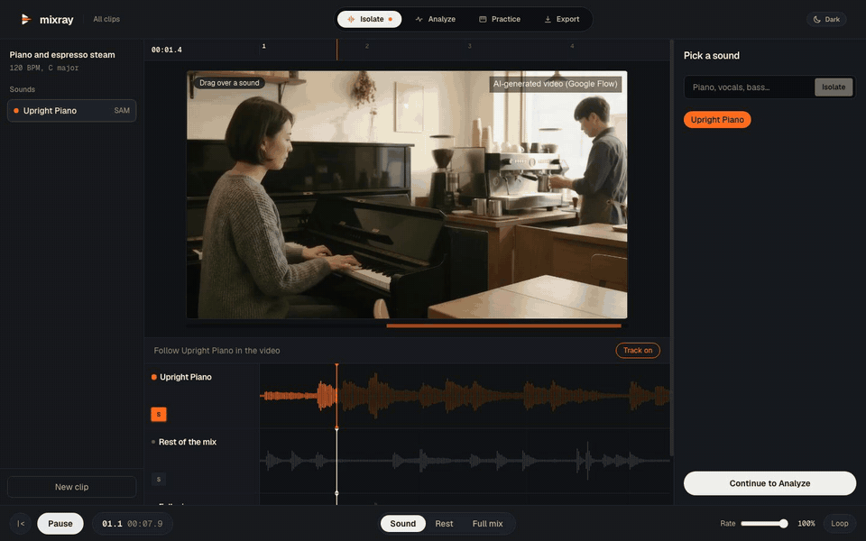
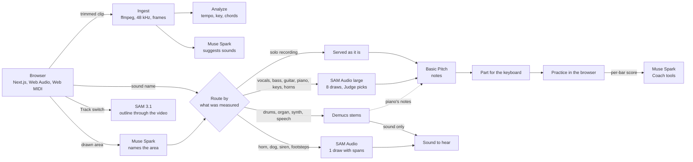

# Mixray

**Point at a sound. Hear it alone. Learn to play it.**

Built with Muse Spark Open

**Live:** https://mixray.vercel.app

**Demo video (2:48):** https://youtu.be/sdNPUq3Tu7o

**Judges:** the access key is in the submission notes.



*Recorded from the app against the live engine. In Practice the keys were pressed by a script on the notes of the part, not by hand. The café clip is AI-generated in Google Flow and labelled as such; see [CREDITS.md](CREDITS.md).*

Drop in a track or a video you own, then pick one sound out of the mix: type what you want, take a
suggestion, or draw over the instrument in the video. Mixray isolates it, shows what it plays and
teaches you to play it on a keyboard, with a coach that reads your take.

Built for the **Meta Global AI Developer Hackathon** (Oct 26 – Nov 4, 2026), problem statement
*Build for Your World*.

**Built during the event.** The first commit is from Oct 26, 2026, and all code in this repository
was written during the hackathon. The models and datasets it uses already existed; they are listed
below and in [CREDITS.md](CREDITS.md).

## Why

I have loved EDM since 2017. Every few weeks a melody from an artist I follow would stay in my head
and I would want to play it. Getting there meant a stem splitter, a transcription app, a tutorial
that might not exist for that song, and a DAW that felt like a cockpit. I am learning keyboard now,
and most of those evenings ended before I played a single bar.

I am not unusual. Making music is common: MIDiA Research counted
[76 million music creators in 2023](https://www.hypebot.com/highlights-from-midias-state-of-the-music-creator-economy-report/),
up 12% in a year. Sticking with it is not. Fender's CEO has said that
[90% of first-time players abandon the instrument within their first year](https://fortune.com/2022/10/21/guitar-industry-fender-ceo-credits-diversity-players-pandemic-revival)
(a figure from the company's own research). In a 2022
[YouGov survey of 3,000 US adults](https://yougov.com/en-us/articles/43512-young-americans-increasingly-exposed-music),
about half of those who never learned an instrument wish they had, and 51% of people who quit the
guitar regret it. The wish is there. The path from "I love this sound" to "I can play it" is what
breaks.

That path runs through recordings. Studying how popular musicians learn by ear,
[Liscio and Brown](https://arxiv.org/abs/2406.04058) write that "the recording stands as the source
of truth for popular musicians." But a recording is a mix, and the tools that turn audio into notes
expect one part at a time: Spotify's Basic Pitch, for one, says it
["works best on one instrument at a time"](https://github.com/spotify/basic-pitch).

Tutorials exist for hit songs. Mixray is for everything else: the piano in the corner of a video,
a street musician's tune, the bass line in a track nobody has covered. Stem splitters give you a
few fixed stems, and the thing you noticed is often not one of them. Mixray starts from what you
noticed: you point at it, in words or on the picture. Then it carries on past the separation, to
the notes, a part sized for your hands, and practice with both hands on the keys and your voice
driving the transport.

## What it does

1. **Add** a clip of up to 30 seconds, or open one of six demos.
2. **Isolate** a sound by name, by suggestion or by drawing an area on the video. Sound, Rest and
   Full mix stay in sync, and Track outlines the chosen instrument through the video.
3. **Analyze** tempo, key, chords, notes and a sound recipe.
4. **Practice** on a MIDI keyboard, the on-screen keys or QWERTY. Your take is scored per bar and the
   Coach can set the loop, the tempo or the hand through fixed tools. A pedal or pad opens the
   microphone for one voice command.
5. **Export** the separated audio, the MIDI parts, the recipe and session notes as a ZIP.

## How it works



`schema/trackmap.schema.json` is the only contract between the web app and the engine. The browser
never sees a model key: every model call goes through a server route or Modal. More in
[ARCHITECTURE.md](ARCHITECTURE.md).

### Models

- **SAM Audio** (Meta, open weights, self-hosted on Modal): prompted sound separation
- **SAM 3.1** (Meta): follows the chosen instrument through the video
- **Muse Spark** (Meta): suggests sounds, names a drawn area, summarises, coaches through tool calls
- **Muse Spark Open** (Meta, open weights under the Muse Model License, via Baseten): the sound recipe.
- **Muse Voice Transcribe** (Meta): hands-free commands while both hands are on the keys
- **Demucs** and **Basic Pitch** (open source): standard stems, and audio to notes

A finding in SAM Audio itself: `SAMAudio.load_state_dict` loads weights only inside `if strict:`, so passing
`strict=False` skips the checkpoint with no error and leaves a model that separates nothing useful. Mixray keeps
`strict=True` and leaves the unused rankers unloaded instead; [SPEC.md](SPEC.md) §7 has the details.

## Evaluation

These measurements shaped the product, including where SAM Audio lost. The rule was to fix the metric before
running, tune on one part of the data and report once on the rest. The calculations and
experiments that were scattered across Colab notebooks are organised in [evaluation](evaluation/README.md),
with their code, printed output and results.

The last column says how each figure was checked again on Nov 2. **Run again** means the measurement was
repeated. **Re-scored** means stored separated audio was decoded and scored again, without a new separation.
Each gave the same result as the first time.

| Decision | Data | Measure | Result | Checked again |
|---|---|---|---|---|
| Read piano notes with a stricter decoder | 20 public-domain Mutopia pieces rendered with Salamander piano, 10 to tune, 10 to report | Note F1, 50 ms | In a band 0.684 → **0.757**, under steam 0.752 → **0.823**, solo 0.791 → **0.885** | Run again |
| Keep Basic Pitch's own note length for guitar | GuitarSet, 180 unseen excerpts, split by player | Note F1, 50 ms | 0.732 → **0.777** | Run again |
| Eight SAM Audio draws, picked by Judge | AlbumDB, 10 unseen targets | Note agreement with the clean stem | First draw 0.281 → **0.479** (Demucs 0.547) | Run again |
| Vocals, bass and guitar stay with SAM Audio | AlbumDB, 7 targets, a subgroup chosen after seeing results | Note agreement | SAM Audio 0.685, Demucs 0.710: a project choice, not a measured win | Run again |
| Answer "not found" for an absent sound | AlbumDB, 120 stems | Level gate at −25 dB | **31 of 31** absent stems caught, 8 of 89 present ones flagged | Re-scored |
| Serve a solo guitar unseparated | GuitarSet, 12 recordings | Note F1, 50 ms | Raw **0.87**, Demucs 0.87, SAM Audio 0.18 | Re-scored |
| Lay SAM Audio's piano onto the real mix as a mask | One demo clip | Steam level, off-beat note starts | Steam 20.2 → 11.8, off-beat starts 8 → 1, same 14 of 16 beats | No |

**What these numbers do not say:**

- Tempo was within 1 BPM on 7 of 12 real guitar recordings and key was right on 5 of 12. On the
  same 12 clips the keyboard part scored about 0.61 on solos and 0.44 on chordal playing.
- Rendered piano is easier than a real recording. Note accuracy on a real recording with known notes for
  every instrument is still open.
- Note agreement compares against notes read from the clean stem, so it judges separation, not the
  note decoder.
- Most sets are small, the steam figure is one clip, and nobody has run a formal listening test.
- The demo clip's steam figure has no script here.
- Running SAM Audio again with the same seeds shows the figures repeat. It does not show they hold on
  other music: the separation rows rest on one album.
- On guitar, 100 ms scored higher than the 127.7 ms the engine uses: 0.787 against 0.777 on the unseen
  players. The engine keeps Basic Pitch's own default rather than a value picked from this table.
- The Coach's words and its tool calls do not always match, and voice and MIDI have been run with
  one keyboard (a Launchkey MK4 49) and one microphone.

## Timeline

Built during the event, Oct 26 to Nov 4, 2026.

| Day | What changed |
|---|---|
| Mon Oct 26 | Repository, spec, design and the TrackMap schema; web scaffold and Modal engine scaffold |
| Tue Oct 27 | SAM Audio running on Modal; upload, job API, separation cache and API key auth |
| Wed Oct 28 | Five-screen studio; tempo, chord and key analysis; Demucs fallback; Basic Pitch notes and keyboard parts; take scoring |
| Thu Oct 29 | MIDI, on-screen keys and QWERTY on one clock; Muse Spark suggestion chips; a tap on the video becomes tracked masks |
| Fri Oct 30 | The Coach through tool calls; sound recipes on Muse Spark Open; voice commands; checked summaries; a tap names the sound |
| Sat Oct 31 (weekend) | Coach, Analyze and Practice rebuilt; first test on real recordings: note F1 0.532 → 0.673 on 12 guitar recordings |
| Sun Nov 1 (weekend) | A day of measurement in Colab, then routing by measurement; areas drawn on the video; keys play the selected sound; a pedal or pad opens the microphone; every screen cut down to what is real |
| Mon Nov 2 | Six demos; clip list with live progress; chips only from Muse Spark; piano through a SAM Audio mask with stricter decoding; Track on Isolate and Analyze; works on phones and tablets; browser audit fixed the Coach, playback and looping; tests, CI, this evaluation and the licence |

## Run it yourself

### Tests only: no accounts needed

Needs Node 22.18 or newer (CI uses 26), [pnpm](https://pnpm.io) 10, [uv](https://docs.astral.sh/uv/) and ffmpeg.

```bash
pnpm install
pnpm lint && pnpm typecheck && pnpm test

cd engine
uv sync --all-groups
uv run ruff check . && uv run mypy . && uv run pytest
uv run python transcribe.fixture.py
```

No test calls a model, a GPU or the network. The engine tests run real uploads through ffmpeg and
real analysis through librosa. Web tests are in `apps/web/tests` and `apps/web/lib/*.fixture.ts`;
engine tests are in `engine/tests`. CI runs all of this on every push. To repeat the measurements, see
[evaluation](evaluation/README.md).

### The whole app

**1. Accounts and keys**

| Service | What for | Name |
|---|---|---|
| [Modal](https://modal.com) | Engine and GPU | `uv run modal token new` |
| Meta Model API | Muse Spark, SAM 3.1, Muse Voice Transcribe | `META_API_KEY` |
| [Baseten](https://baseten.co) | Muse Spark Open | `BASETEN_API_KEY` |
| [Hugging Face](https://huggingface.co/facebook/sam-audio-large), after accepting the model's licence | SAM Audio weights | `HF_TOKEN` |
| You | Any long random string shared by the web app and the engine | `MIXRAY_API_KEY` |

**2. Engine**

```bash
cd engine
uv sync --all-groups
uv run modal secret create mixray-secrets META_API_KEY=... MIXRAY_API_KEY=...
uv run modal secret create mixray-baseten BASETEN_API_KEY=...
uv run modal secret create mixray-hf HF_TOKEN=...
uv run modal deploy app.py    # on macOS: MODAL_DISABLE_API_PROXY=1 uv run modal deploy app.py
```

Deploying prints the engine's URL. The volumes are created on first use, and the first separation
downloads the weights, so it is slow. An eight-draw separation uses an A100 40 GB for about 88 s,
roughly $0.05. Use `uv run modal serve app.py` to work on the engine with hot reload.

If the web app is not on `localhost:3000`, add `MIXRAY_CORS_ORIGINS=https://your.domain` (comma
separated) to `mixray-secrets`.

**3. Web**

Create `apps/web/.env.local`:

```bash
MIXRAY_ENGINE_URL=https://...modal.run
MIXRAY_API_KEY=...          # the same value as on the engine
META_API_KEY=...            # for the Coach and voice routes
MIXRAY_ACCESS_KEY=...       # entered on the landing page, or in a link: /?key=...; without it, the studio stays closed
MIXRAY_DEMO_VIDEO_URL=...   # optional: a YouTube or https video link shown on the landing page
```

```bash
pnpm dev                      # http://localhost:3000
```

To host it on Vercel, set the root directory to `apps/web` and add the same variables.

**Limits** are in `engine/ingest.py`: 50 MB and 6 minutes per upload, 30 s per clip, and 25 clips and
50 separations per IP per day (`MIXRAY_DAILY_CLIP_QUOTA`, `MIXRAY_DAILY_ISOLATION_QUOTA`). Clips are
deleted after 7 days.

A MIDI keyboard needs a browser with Web MIDI, such as Chrome, Edge or Brave. QWERTY works anywhere.

## Demos

The studio offers six demos as shortcuts: clicking one opens Add with its video and sound already
chosen, and it then goes through the same pipeline as any upload. There are five AI-generated scenes
(a café piano under espresso steam, a song in a park, a busker with a dog and a taxi, a rooftop
singer, a piano on a rainy night) and one real recording, a public-domain U.S. Navy Band performance.
Each is labelled Real recording or AI-generated, and the AI-generated videos carry a watermark.

AI-generated scenes made with Google Flow by Mehmet Yildiz; real recording: U.S. Navy Band, public domain.

Most are generated because an open licence on a video of musicians rarely covers the music they
play; [CREDITS.md](CREDITS.md) explains this and lists each one. They are test material, not evidence
of accuracy on real recordings. `node scripts/build_demos.mjs <engine-url>` rebuilds the videos and
their stills.

## Licence and rights

The code is under the [MIT License](LICENSE). Demo media, models and data are not: they keep their own terms,
listed in [CREDITS.md](CREDITS.md). Upload only music or video you own or have the rights to.
